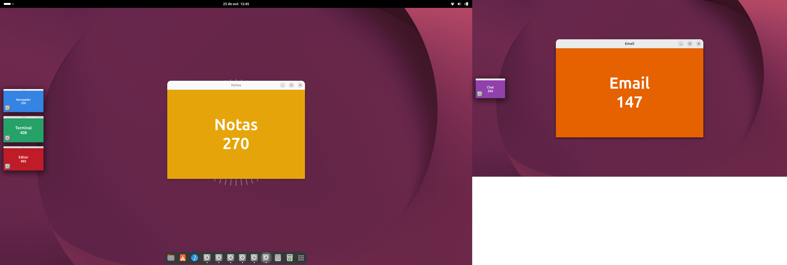
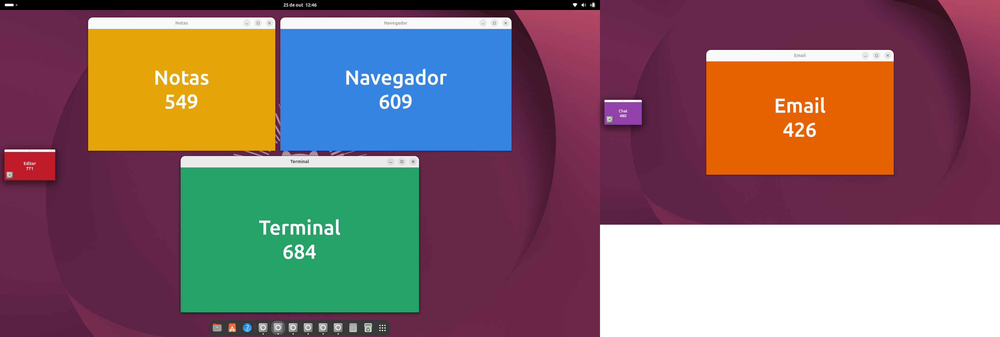

# Stage Manager for GNOME

A Stage Manager (the macOS window organizer) for GNOME Shell: **one centered window or group on the stage**, recent
apps in a **strip of live thumbnails** on the side, groups built by drag-and-drop, and an optional **Pop Shell-style
autotiling**. Extension UUID: `stage-manager@wyliam`.

Português: [README.pt-BR.md](README.pt-BR.md)




## Features

- **Stage + strip.** The active window is centered; everything else sits in a strip (left by default) with live
  thumbnails and the app icon. Click a thumbnail to swap; the previous window takes its slot, with the native
  minimize animation flying to/from the strip.
- **Groups.** Drag a thumbnail onto the stage, **Shift+click**, or use the **+** button on the thumbnail. To remove a
  window, drag it onto the strip (a drop target shows up even when the strip is empty) or use the shortcut.
- **Mosaic layout** (default): 2 windows side by side, 3+ in justified rows keeping each window's aspect ratio.
  Resizing a window keeps the size you asked for and the others make room; dropping a window onto another swaps them.
- **Autotiling** (option, like Pop Shell): windows on the stage fill the screen in a tree layout, resizing moves the
  divider, dropping onto another window swaps them. Configurable margin and gap; the strip can stay visible or hide.
- **Always centered** option: the window (or group) snaps back to the center as soon as you drop or resize it.
  Otherwise windows you moved by hand stay where you left them.
- **Strip behind windows**, like macOS: a big window simply covers/cuts it; touch the screen edge to bring it forward when it is fully hidden.
- **Picture-in-Picture** (Firefox, Chrome): joins the group of the stage where it appears and goes away with it. Only its
  width takes part in tiling; the height follows the video aspect ratio, in the corner of your choice (drag it to move).
- **Exceptions**: pick any open window with the mouse (like Pop Shell), toggle with a shortcut, or from the strip menu.
  GNOME Sushi is ignored by default.
- **Context menu on the strip** (right click): bring to stage, add to group, bring only one window, split, new window, close,
  quit app, move to another monitor/workspace, toggle autotiling, rearrange, show desktop, ignore app, preferences.
- Click the wallpaper to reveal the desktop; per-monitor and per-workspace stages; auto-hide strip; Quick Settings toggle.
- Translated into 8 languages (see below).

## Requirements

GNOME Shell **50** (developed and tested on Ubuntu 26.04, Wayland). `glib-compile-schemas` (package `libglib2.0-bin`).
Other GNOME Shell versions are not tested; PRs welcome.

## Install

```bash
git clone https://github.com/wylho/gnomestagemanager.git
cd gnomestagemanager
./install.sh                           # copies to ~/.local/share/gnome-shell/extensions (does not enable anything)
# log out and back in (Wayland only discovers new extensions that way), then:
gnome-extensions enable stage-manager@wyliam
```

Tips: put the dock at the bottom (`gsettings set org.gnome.shell.extensions.dash-to-dock dock-position BOTTOM`);
stop GNOME from auto-maximizing new windows (`gsettings set org.gnome.mutter auto-maximize false`);
disable other tiling/window managers (e.g. Pop Shell), they fight over window positions.

## Shortcuts (configurable in Preferences)

| Action | Default |
|---|---|
| Turn Stage Manager on/off | Super+Alt+S |
| Turn autotiling on/off | Super+Alt+T |
| Switch to the most recent set in the strip | Super+Alt+Up |
| Add the most recent set to the stage | Super+Alt+Right |
| Remove the focused window from the group | Super+Alt+Left |
| Rearrange / center the group | Super+Alt+R |
| Show the desktop | Super+Alt+D |
| Pick a window to ignore (mouse) | Super+Alt+E |
| Ignore / manage again the focused app | Super+Alt+X |

## Translations

English (source), plus: Brazilian Portuguese, Spanish, French, German, Russian, Italian, Simplified Chinese and Japanese
(`po/*.po`). **The translations were produced with AI assistance and have not been reviewed by native speakers**:
corrections are very welcome. To improve or add a language:

```bash
sudo apt install python3-babel
# edit po/<lang>.po  (or add the language to LANGS in tools/i18n.py, then:)
python3 tools/i18n.py extract && python3 tools/i18n.py update   # refresh from the code
python3 tools/i18n.py check                                     # nothing missing, formats match
python3 tools/i18n.py compile                                   # writes the .mo files used by the extension
```

## Development

No need to log out to try changes: `sandbox/` runs an isolated headless GNOME Shell (own D-Bus, GSettings and Wayland
socket) with scripted scenarios that simulate mouse and keyboard and save screenshots.

```bash
sandbox/preview.sh interact                   # click, Shift+click, drag, remove  -> sandbox/out/*.png
sandbox/preview.sh mosaic2 1920x1080,1280x720 # two monitors
tests/run-all.sh                              # unit tests + random "chaos" test (1 and 2 monitors)
```

Layout of the repo: `extension/` (the extension), `po/` (translations), `tools/` (i18n helper), `sandbox/` (isolated shell +
scenarios), `tests/`, `docs/` (research on the macOS behavior, in Portuguese). Code comments are in Portuguese.

## Limitations

- Groups are not persisted across restarts. Code changes of an extension in use only load after logging out and in (Wayland).
- Windows that cannot be minimized stay visible. Desktop-icon extensions that use their own window sit above the strip.

## License

Copyright (C) 2026 wylho. Licensed under the **GNU General Public License, version 3 or (at your option) any later
version** (`GPL-3.0-or-later`); see [LICENSE](LICENSE). Contributions are accepted under the same license.
