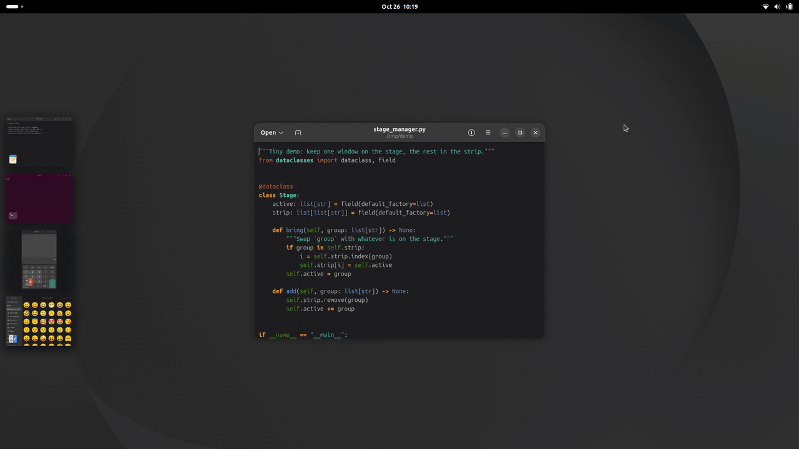
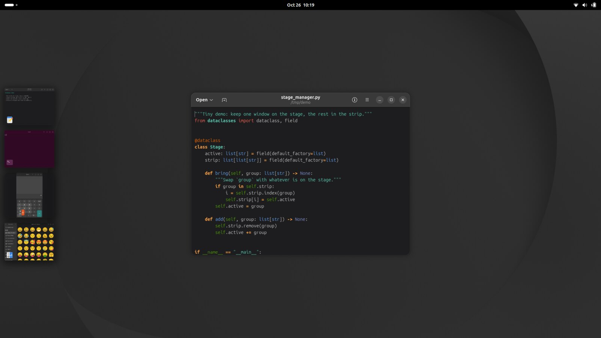
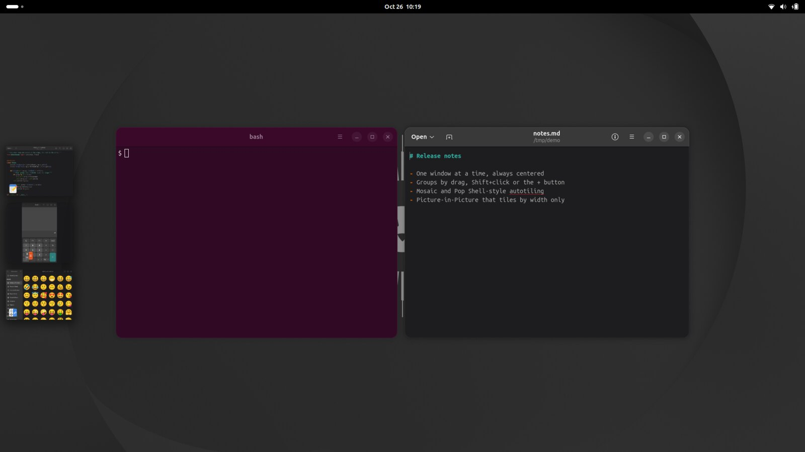
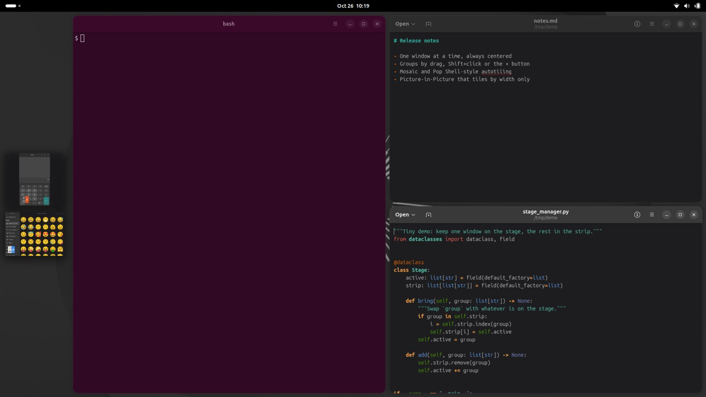
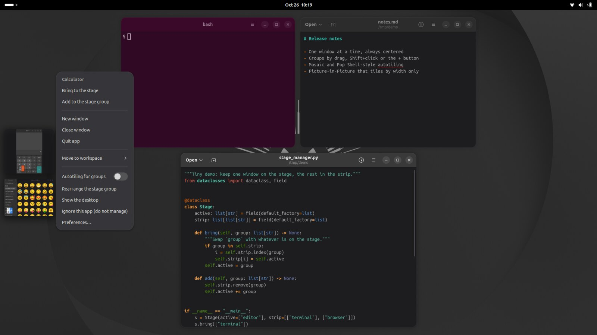

<h1 align="center">Stage Manager (Organizador Visual) para o GNOME</h1>

<p align="center">
  <b>O organizador de janelas do macOS, refeito para o GNOME — e com tudo que a Apple deixou de fora.</b><br>
  Uma janela centralizada. O resto a um clique. Tiling quando você quiser.
</p>

<p align="center">
  
  
  
  
</p>

<p align="center">
  
</p>

> English: [README.md](README.md)

## Por que você vai gostar

- **Foco por padrão.** A janela (ou grupo) ativa fica centralizada no *palco*. O resto espera numa *tira* lateral de **miniaturas ao vivo**
  que continuam atualizando mesmo escondidas, com a animação nativa de minimizar voando de e para ela.
- **Grupos em um gesto.** Arraste a miniatura para o palco, use **Shift+clique** ou o botão **+**. Para tirar, arraste a janela de volta
  para a tira (que mostra um alvo de soltura até quando está vazia).
- **Dois jeitos de organizar, à sua escolha.** O **Mosaico** mantém a forma de cada janela e abre espaço quando você redimensiona uma.
  O **Autotiling** (estilo Pop Shell) preenche a tela em árvore, move os divisores ao redimensionar e troca as janelas quando você solta uma sobre a outra.
- **Picture-in-Picture que se comporta.** O PiP do Firefox/Chrome entra no palco em que aparece e sai com ele; só a **largura** entra no
  tiling, a altura segue o vídeo, no canto que você escolher.
- **Feito para o uso real.** Um palco por monitor e por área de trabalho, tira dos dois lados (funciona com dock embaixo), clique no papel
  de parede para espiar a área de trabalho, botão nas Configurações Rápidas, nativo no Wayland.
- **Do seu jeito.** Mais de 20 opções, 9 atalhos, menu de botão direito em cada miniatura, um seletor de *exceções* por clique e 9 idiomas.

## Tudo que ela faz, ao lado do macOS

*Coluna do macOS: documentação da Apple e análises publicadas ("—" = não documentado). A pesquisa está em [docs/ESPECIFICACAO.pt-BR.md](docs/ESPECIFICACAO.pt-BR.md).*

| | Stage Manager do macOS | Esta extensão |
|---|:---:|:---:|
| Janela/grupo ativo centralizado num palco | Sim | **Sim** |
| Tira de apps recentes com miniaturas ao vivo | Sim | **Sim** |
| Clicar na miniatura troca (a antiga ocupa o lugar) | Sim | **Sim** |
| Montar grupos arrastando da tira | Sim | **Sim** |
| Shift+clique para adicionar ao palco | Sim | **Sim** |
| Arrastar a janela de volta à tira para removê-la | Sim | **Sim** |
| Tira atrás das janelas, revelada na borda da tela | Sim | **Sim** |
| Auto-ocultar a tira | Sim | **Sim** |
| Clicar no papel de parede mostra a área de trabalho | Sim | **Sim** |
| "Uma por vez" / "Todas de uma vez" por app | Sim | **Sim** |
| Um palco por tela e por área de trabalho | Sim | **Sim** |
| Atalho rápido no menu do sistema | Sim | **Sim** |
| **Atalhos de teclado** para ligar, trocar, adicionar, remover, reorganizar | Não | **Sim (9, configuráveis)** |
| **Menu de botão direito** nas miniaturas (trazer, adicionar, separar, fechar, sair, mover de monitor/área, ignorar…) | Não | **Sim** |
| **Botão +** nas miniaturas (dá para desligar) | Não | **Sim** |
| **Organização automática** do grupo (janelas nunca se sobrepõem) | Não (livres) | **Mosaico ou autotiling** |
| **Autotiling** com margem e espaçamento configuráveis, divisores que seguem o redimensionamento | — | **Sim** |
| Redimensionar uma janela e as outras abrem espaço (ela fica com o tamanho pedido) | — | **Sim** |
| Redimensionar a partir do centro: por padrão, ou só segurando **Alt** (fora do autotiling) | Tecla Option, depende do app | **Sim** |
| Soltar uma janela sobre outra para trocar de lugar | — | **Sim** |
| **Picture-in-Picture** tratado como tile só de largura num canto | — | **Sim** |
| **Seletor de exceções**: clique em qualquer janela para ignorar o app (GNOME Sushi já vem ignorado) | — | **Sim** |
| Modo "**manter sempre centralizada**", ou lembrar o que você moveu à mão | — | **Sim** |
| Mover um conjunto para outro monitor ou área de trabalho pelo menu | — | **Sim** |
| Arrastar janelas **e miniaturas da tira entre monitores**: soltar sobre um item da tira agrupa, na tira só muda de monitor, sobre uma janela aberta você escolhe *Agrupar* ou *Só mudar de monitor* | — | **Sim** |
| **Alt+Tab na ordem de uso** com vários monitores (um toque = o app que você acabou de deixar) | Sim (Command-Tab) | **Sim** |
| Traduções | Idiomas do sistema | **9 (EN, PT-BR, ES, FR, DE, RU, IT, ZH-CN, JA)** |

## Um passeio rápido

<table>
  <tr>
    <td width="50%"><br><b>Palco e tira.</b> Uma janela centralizada; o resto em miniaturas ao vivo.</td>
    <td width="50%"><br><b>Mosaico.</b> Adicione uma janela ao palco e o grupo se arruma sozinho.</td>
  </tr>
  <tr>
    <td width="50%"><br><b>Autotiling.</b> As janelas preenchem a tela; a tira continua ao lado.</td>
    <td width="50%"><br><b>Menu de botão direito.</b> Tudo que dá para fazer com uma miniatura.</td>
  </tr>
</table>

## Instalação

```bash
git clone https://github.com/wylho/gnomestagemanager.git
cd gnomestagemanager
./install.sh                           # copia para ~/.local/share/gnome-shell/extensions (não habilita nada)
# saia e entre na sessão (no Wayland só assim o GNOME descobre extensões novas), depois:
gnome-extensions enable stage-manager@wyliam
```

Requer **GNOME Shell 50** (desenvolvido e testado no Ubuntu 26.04, Wayland) e `glib-compile-schemas` (`libglib2.0-bin`).
Dicas: dock embaixo (`gsettings set org.gnome.shell.extensions.dash-to-dock dock-position BOTTOM`); impedir que o GNOME maximize janelas novas
sozinho (`gsettings set org.gnome.mutter auto-maximize false`); desligar outros gerenciadores de janelas/tiling (Pop Shell etc.), eles disputam as posições.

## Atalhos (todos configuráveis)

| Ação | Padrão |
|---|---|
| Ligar/desligar o Organizador Visual | `Super+Alt+S` |
| Ligar/desligar o autotiling | `Super+Alt+T` |
| Trocar para o conjunto mais recente da tira | `Super+Alt+Cima` |
| Adicionar o conjunto mais recente ao palco | `Super+Alt+Direita` |
| Tirar a janela em foco do grupo | `Super+Alt+Esquerda` |
| Reorganizar / centralizar o grupo | `Super+Alt+R` |
| Mostrar a área de trabalho | `Super+Alt+D` |
| Escolher uma janela a ignorar (com o mouse) | `Super+Alt+E` |
| Ignorar / gerenciar de novo o app em foco | `Super+Alt+X` |

## Deixe do seu jeito

Abra as *Preferências* (ou botão direito numa miniatura > Preferências). Destaques: lado da tira e largura das miniaturas, mostrar/ocultar recentes,
uma por vez ou todas juntas, mosaico, livre ou autotiling (margem, espaçamento, visibilidade da tira), manter centralizada e lembrar posição,
canto/largura/padrões de título do PiP, o botão +, clique no papel de parede, lista de exceções e todos os atalhos.

## Feita para dar confiança

Gerenciador de janelas não perdoa erro, então esta foi testada como tal:

- **Sandbox com um GNOME Shell isolado** (`sandbox/`): um shell sem tela, com D-Bus, configurações e socket Wayland próprios, que roda roteiros
  (mouse, teclado, apps reais do GNOME) e salva capturas, para testar sem sair da sessão. A demonstração acima foi gravada nele.
- **Teste de caos**: operações aleatórias de abrir/fechar/trocar/minimizar/maximizar/mover de monitor/ligar e desligar opções, conferindo
  invariantes a cada passo, com 1 e 2 monitores nos dois modos de áreas de trabalho do GNOME.
- Testes unitários do layout, da árvore de tiling e do modelo; instalação atômica que nunca mexe nos arquivos de um Shell em execução.
- Projetada a partir de um estudo da documentação da Apple, Ars Technica, MacStories, Six Colors, Eclectic Light e outros, inclusive do que os
  revisores criticaram (sem atalhos, agrupar é trabalhoso, tira atrapalhando).

```bash
sandbox/preview.sh interact                    # testar sem sair da sessão -> sandbox/out/*.png
sandbox/preview.sh mosaic2 1920x1080,1280x720  # dois monitores
tests/run-all.sh                               # testes unitários e de caos
```

## Traduções

Inglês (base) mais português do Brasil, espanhol, francês, alemão, russo, italiano, chinês simplificado e japonês (`po/*.po`).
**Foram feitas com apoio de IA e ainda não foram revisadas por falantes nativos: correções são muito bem-vindas.**
Os comandos estão em [README.md](README.md#translations).

## Limites, com honestidade

- Por enquanto só **GNOME Shell 50** (outras versões sem teste); desenvolvida no Wayland, X11 não testado.
- O PiP é reconhecido pelo título da janela (`Picture-in-Picture`, `Picture in picture`; editável). Foi testado com janelas simuladas; o PiP real do
  Firefox/Chrome ainda precisa de teste de campo, então avise o que você observar.
- Os grupos não persistem entre reinicializações. Janelas que não podem ser minimizadas ficam visíveis. O código de uma extensão já em execução só
  recarrega depois de sair e entrar na sessão (limitação do Wayland).
- Os comentários do código estão em português.

## Veja também

Outros projetos do GNOME com a mesma inspiração, com objetivos e pontos fortes diferentes:
[Stage Manager (extensions.gnome.org)](https://extensions.gnome.org/extension/9528/stage-manager/)
(GNOME 46–50, X11 e Wayland, vários modos de barra lateral). Escolha o que combina com o seu setup.

## Contribuindo

Issues e PRs são bem-vindos, principalmente traduções, outras versões do GNOME e testes no X11. Rode `tests/run-all.sh` antes de enviar um PR.

## Licença

Copyright (C) 2026 wylho. Licenciado sob a **GNU General Public License, versão 3 ou (a seu critério) qualquer versão posterior**
(`GPL-3.0-or-later`); veja [LICENSE](LICENSE). Contribuições são aceitas sob a mesma licença.
